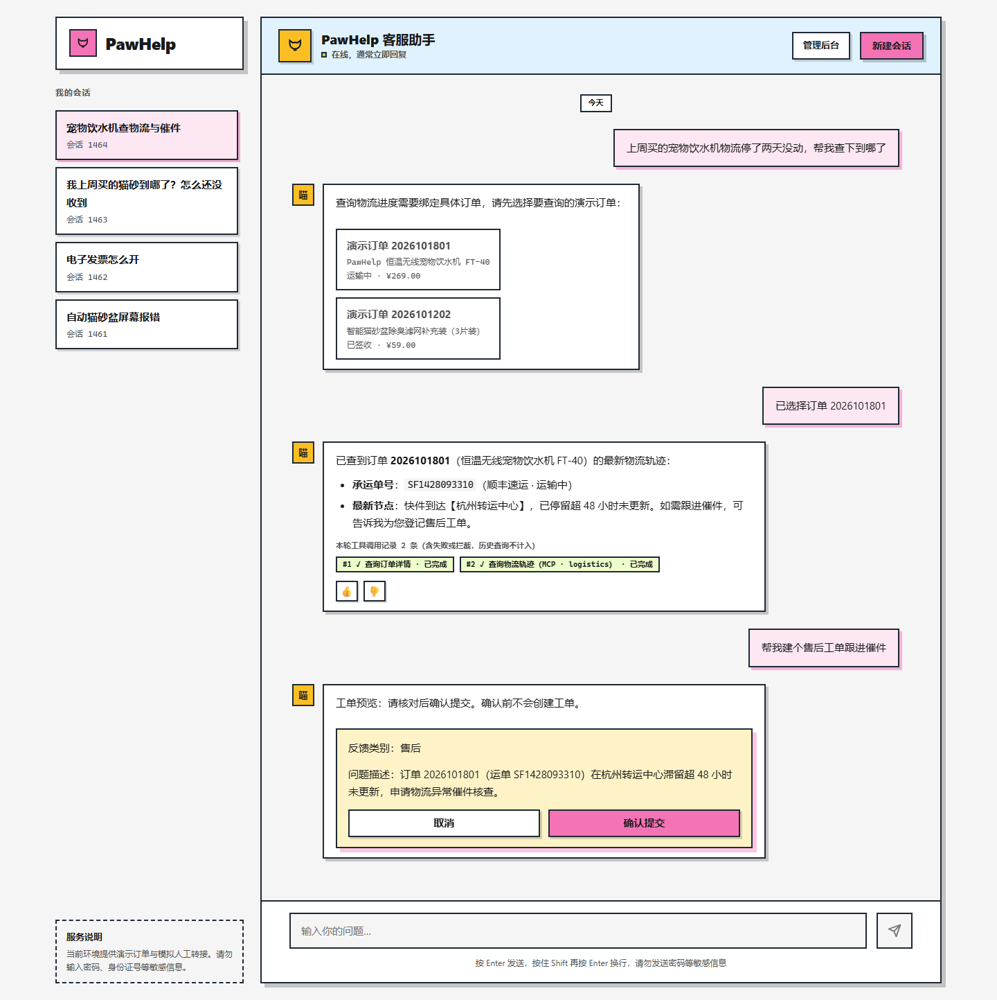
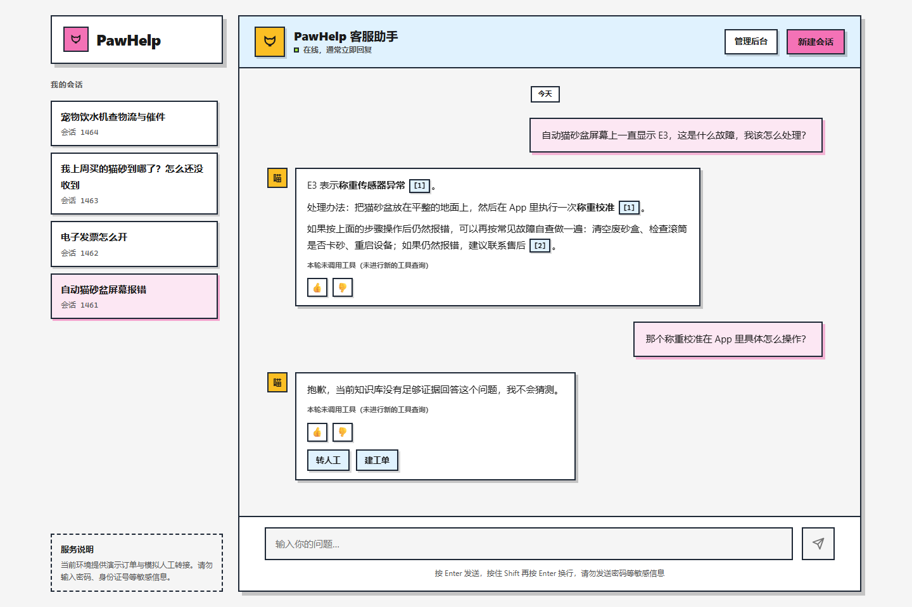
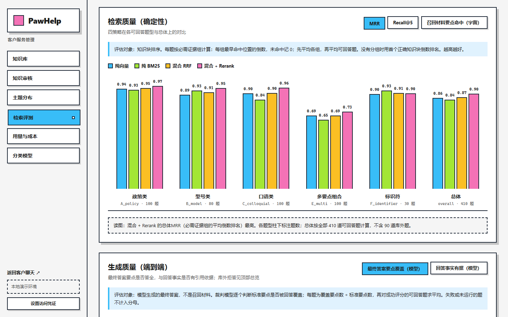
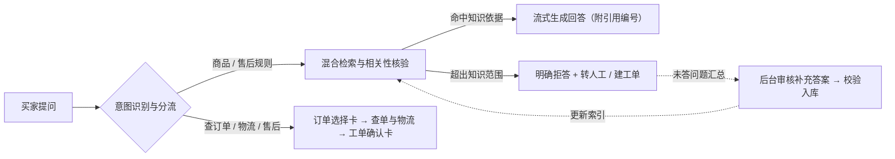

# PawHelp

[](https://github.com/yzd05/PawHelp/actions/workflows/source-checks.yml)
[](pyproject.toml)
[](LICENSE)
[](CHANGELOG.md)
[](https://m8ven.ai/mcp/yzd05-pawhelp-e9nxnf?s=readme)

<details>
<summary><b>English Overview (Click to expand)</b></summary>

**PawHelp** (`v0.1.0`) is a self-hosted e-commerce customer-support system built with **FastAPI, LangGraph, MySQL 8.4, and Milvus 2.6**.
- **Policy & Product Q&A**: Combines dense vector search, BM25 keyword matching, and reranking to answer after-sales rules and troubleshooting questions with source citations, refusing out-of-scope queries with human-handoff options.
- **Order Lookup & Two-Step Confirmation**: Orchestrates order lookup, real-time MCP logistics tracking, and after-sales requests via a deterministic workflow with interactive order-selection and ticket-confirmation cards.
- **Knowledge Console & Evaluation**: Provides multi-turn conversation memory, Markdown knowledge sync, an operator review queue for unanswered questions, and a 500-case retrieval evaluation dashboard.

</details>

面向宠物用品电商的智能客服系统，基于 **FastAPI + LangGraph + MySQL 8.4 + Milvus 2.6** 构建，提供商品与售后知识问答、订单与物流查询、售后工单确认及后台知识库运营功能。

## 主要功能

- **政策与商品问答**：结合向量检索、关键词匹配与重排序回答售后规则、商品规格和故障排查问题，回复附带原文引用编号；超出知识库范围时明确拒答，并提供`转人工`与`建工单`入口。
- **订单查询与双卡确认**：通过确定性工作流串联查订单、查实时物流（MCP 接入）与售后申请；遇到多笔订单时弹出**订单选择卡**，创建售后工单前弹出**工单确认卡**，经用户确认后才落库。
- **多轮对话与上下文记忆**：支持多会话切换、流式回复与长对话自动分段摘要，在连续追问中保留商品与订单上下文。
- **知识库管理与问题回流**：后台支持同步 Markdown 知识文档、手工录入问答、从历史会话提取常见问答；线上未命中的问题自动汇总至审核台，人工补充答案并校验无冲突后即可入库。
- **检索评测与用量统计**：内置 500 题检索对比评测看板、买家问题分类统计与 Token 用量记录，克隆仓库即可直接浏览基准评测结果。

## 界面预览



<table width="100%">
  <tr><th width="50%">知识问答与超纲拒答</th><th width="50%">检索与生成评测看板</th></tr>
  <tr><td width="50%" valign="top"></td><td width="50%" valign="top"></td></tr>
  <tr><th width="50%">知识库管理</th><th width="50%">待答问题审核</th></tr>
  <tr><td width="50%" valign="top"></td><td width="50%" valign="top"></td></tr>
</table>

## 业务流程



## 检索评测

基于项目内 16 份知识文档（97 个知识块）构建 500 题测试集（含 410 道可答题与 90 道超纲拒答题），四种检索策略对比如下：

| 策略 | Recall@5 | MRR | 口语提问 MRR | 多要点 Recall@5 | 故障码与型号 MRR |
|---|---:|---:|---:|---:|---:|
| `dense`（向量检索） | 0.980 | 0.859 | 0.903 | 0.947 | 0.897 |
| `bm25`（关键词匹配） | 0.976 | 0.842 | 0.842 | 0.947 | **0.930** |
| `hybrid`（混合召回） | 0.983 | 0.866 | 0.905 | 0.952 | 0.906 |
| **`hybrid + rerank`（混合 + 重排）** | **0.997** | **0.900** | **0.956** | **0.992** | 0.904 |

混合检索结合重排序在整体召回（Recall@5 `0.997`）和日常口语提问排序（MRR `0.956`）上表现最好，同时 90 道超纲题全部准确拒答。数据集构造方法与详细实验记录见 [evals/README.md](evals/README.md) 及 [`reports/retrieval-evaluation.md`](reports/retrieval-evaluation.md)。

## 快速启动

环境要求：Python 3.12、[uv](https://docs.astral.sh/uv/) 与 Docker。首次启动会下载约 3.3 GB 检索与重排模型权重（国内网络可设置 `HF_ENDPOINT=https://hf-mirror.com`；若本机配了自定义 `UV_INDEX_URL`，执行 `--locked` 前请先清除以免与官方锁文件冲突）。

```bash
uv sync --locked
cp .env.example .env            # PowerShell: Copy-Item .env.example .env（填入 OPENAI_API_KEY 等配置）
uv run --locked pawhelp-start --bootstrap

# 分步启动基础设施与初始化：
docker compose up -d --wait mysql etcd minio milvus && uv run --locked alembic upgrade head
uv run --locked python -m scripts.ingest_knowledge && uv run --locked python -m scripts.vectorize_knowledge
uv run --locked python -m scripts.start
```

启动后访问 <http://127.0.0.1:8000/> 进入客服前台，<http://127.0.0.1:8000/admin> 进入管理后台；离线测试可直接运行 `uv run pytest`（使用内置模拟模型，无需 API 密钥）。更多说明见 [docs/operations.md](docs/operations.md)。

| 页面 | 路径 | 说明 |
|---|---|---|
| 智能客服前台 | `/` | 多会话流式对话、订单选择卡、工单确认卡与原文引用查看 |
| 知识库管理 | `/kb` | Markdown 文档切分同步、手工录入问答、向量索引更新与检索调试 |
| 待答问题审核 | `/review` | 未命中提问归并查重、标准答案修订与无冲突发布入库 |
| 主题分布 | `/topics` | 买家待答问题的 17 类主题统计 |
| 检索评测 | `/rag-eval` | 四种检索策略对比、生成质量指标与错题筛选（内置基准快照） |
| 用量与成本 | `/observability` | 按意图统计 Token 用量、调用成本估算与评测趋势 |
| 分类模型 | `/acceptance` | 主题分类模型的测试指标与样本复核 |

## 目录结构

```text
app/
  workflow/     确定性对话工作流、意图分流、选单与工单确认、多轮分段记忆
  knowledge/    文档切分、向量化与重排序、混合检索、入库冲突检查
  tools/        订单查询、物流与售后工具注册及调用校验
  api/          HTTP / SSE 路由与管理端鉴权
  topics/       买家问题 17 类主题分类服务
mcp_servers/    物流查询与售后服务 MCP 演示节点
docs/adr/       核心设计决策记录（0001–0004）
evals/          500 题检索、意图分流与知识冲突评测集
tests/          离线单元测试、浏览器渲染检查与 MySQL 集成测试
```

## 相关文档

- **系统与设计记录**：[领域说明 (CONTEXT.md)](CONTEXT.md) · [模块职责说明](docs/project-structure.md) · [ADR 0001：MySQL 与 Milvus 数据同步](docs/adr/0001-mysql-authority-and-milvus-derived-index.md) · [ADR 0002：确定性工作流与双卡确认](docs/adr/0002-deterministic-graph-and-two-stage-interrupts.md) · [ADR 0003：检索相关性门控与分流实验](docs/adr/0003-calibrated-evidence-gate-and-jev-routing.md) · [ADR 0004：多轮会话分段记忆](docs/adr/0004-immutable-three-layer-session-memory.md)
- **评测、运维与开源说明**：[评测集与实验记录](evals/README.md) · [运行与部署说明](docs/operations.md) · [业务数据接入](docs/data-integration.md) · [分类模型说明](docs/topic-classifier.md) · [贡献指南](CONTRIBUTING.md) · [安全说明](SECURITY.md) · [更新日志](CHANGELOG.md) · [MIT License](LICENSE)
