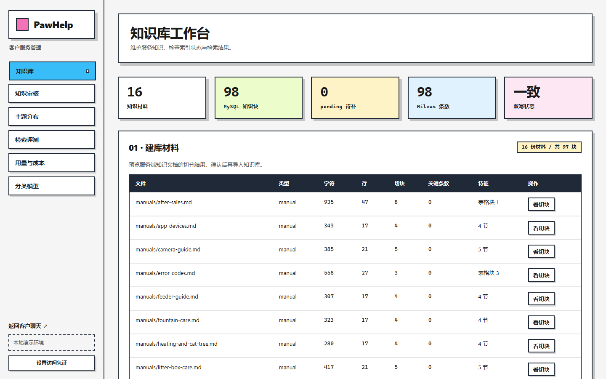
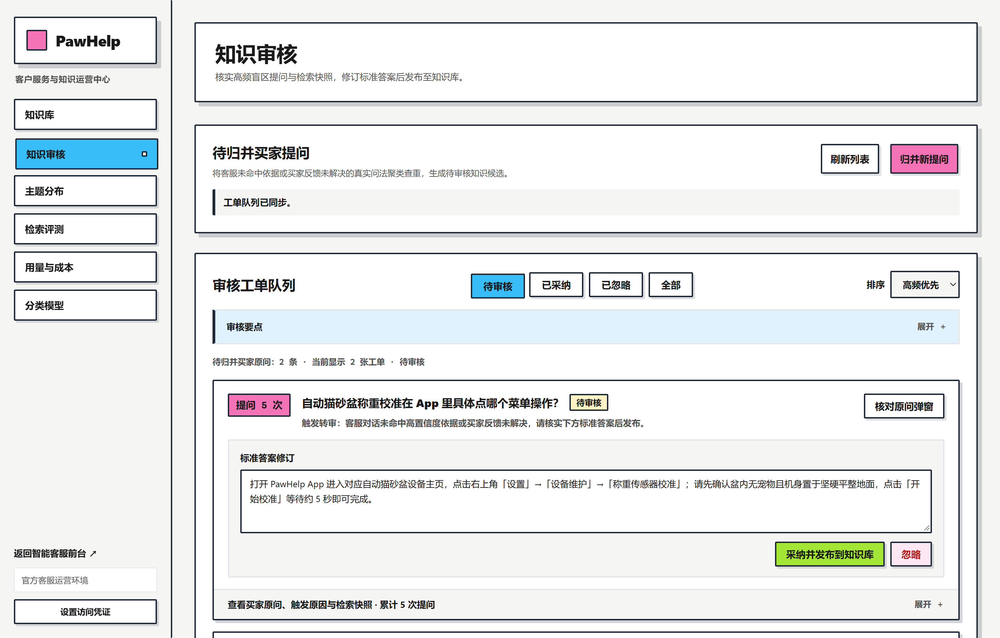
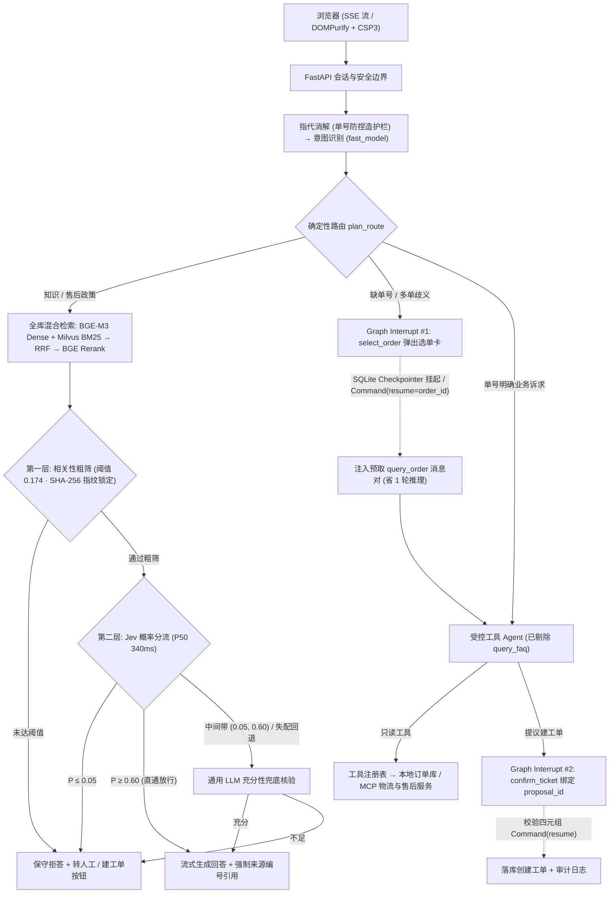
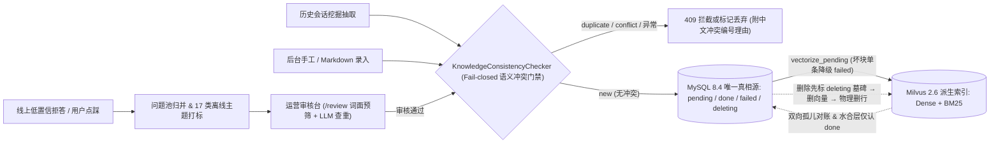

# PawHelp

[](https://github.com/yzd05/PawHelp/actions/workflows/source-checks.yml)
[](pyproject.toml)
[](LICENSE)
[](CHANGELOG.md)

<details>
<summary><b>English Overview (Click to expand)</b></summary>

**PawHelp** is a self-hosted e-commerce customer-support agent built with **FastAPI, LangGraph, MySQL 8.4, and Milvus 2.6**.
- **Deterministic Graph & Two-Stage Interrupts**: Combines deterministic pre-routing (`resolve_reference → classify_intent → route`) with SQLite-checkpointed interrupts for ambiguous order selection (`select_order`) and write-gated ticket creation (`confirm_ticket`), resumable across restarts via `Command(resume)`.
- **Hybrid RAG & Calibrated Two-Tier Gate**: `BAAI/bge-m3` dense + Milvus BM25 recall with RRF fusion and `bge-reranker-v2-m3` lifts 500-case **Recall@5 from `0.980` to `0.997`** and colloquial **MRR from `0.842` to `0.956`**.
- **System-One Probabilistic Routing (TypeSafe Jev)**: Paired with a SHA-256 fingerprint-locked relevance prefilter (`0.174`), calibrated Jev (`P50 340 ms`, `~$0.025` per 499 checks) offloads **92.3%** of LLM sufficiency checks (**93.5%** with **0 false accepts / 0 false refusals** on the 77-case served hold-out split) while holding **90/90** out-of-scope refusals and **0.995** faithfulness.
- **Closed-Loop Knowledge Flywheel & Dual-Write Consistency**: Fail-closed `KnowledgeConsistencyChecker` blocks duplicate/contradictory writes; a `pending / done / failed / deleting` state machine reconciles MySQL (source of truth) with Milvus without 2PC.
- **Production-Grade Hardening**: Immutable three-layer session memory with protocol-safe tool-pair trimming, strict CSP3 + DOMPurify XSS defense, fast/main model split, and keyless MySQL 8.4 integration CI. See [Architecture Decision Records](docs/adr/0001-mysql-authority-and-milvus-derived-index.md).

</details>

宠物用品电商的智能客服系统：基于 **FastAPI + LangGraph + MySQL 8.4 + Milvus 2.6**，覆盖混合检索问答（RAG）、订单与 MCP 物流查询、退款与工单两阶段确认、不可变三层多轮记忆，以及一套把“答不上的问题”安全回写知识库的运营飞轮。

## 亮点

- **确定性外骨骼 + 两阶段可恢复图中断**：LangGraph 编排“指代消解 → 意图识别 → 确定性路由 → 强制前置检索或工具 Agent”。缺单号时以 `select_order` 中断弹出订单卡，恢复后将预取订单直接注入首轮 `query_order` 工具消息对（**省去 1 轮大模型推理 + 1 次重复查单**）；建工单前以 `confirm_ticket` 绑定 `proposal_id` 等待前端二次确认；检查点落盘 SQLite，跨重启可接着上次中断继续（[ADR 0002](docs/adr/0002-deterministic-graph-and-two-stage-interrupts.md)）。
- **混合检索 + 双层校准门控 + Jev 概率分流**：BGE-M3 稠密向量 + Milvus BM25 双路召回、RRF 融合与 BGE 重排，在 500 题基准上将 **Recall@5 提升至 `0.997`、口语类 MRR 从 `0.842` 拉升至 `0.956`**。回答前必过 SHA-256 指纹锁定的相关性粗筛（`0.174`）与充分性核验；接入 TypeSafe Jev 后以 **`P50 340 ms` 直接分流 `92.3%` 核验请求**（独立留出集线上分流 **`93.5%`、零误放零误拒**），库外 90 题 **100% 拒答**并附上`转人工 / 建工单`入口（[ADR 0003](docs/adr/0003-calibrated-evidence-gate-and-jev-routing.md)）。
- **三层不可变会话记忆与防篡改护栏**：摒弃易串改单号的滚动重写摘要，采用“近期原文（强制 `_has_complete_tool_pairs` 协议级配对裁剪）+ 中间工具半压 + 后台异步追加分段摘要（中文数字等价白名单防捏造，失败绝不推进锚点）”；指代改写捏造单号即刻丢弃（[ADR 0004](docs/adr/0004-immutable-three-layer-session-memory.md)）。
- **受控工具网关与前端安全纵深**：统一工具注册表负责 Schema 校验、只读重试、写前确认与审计日志，物流与售后经 MCP 白名单接入；全站 6 个页面零内联脚本/样式，配合 **DOMPurify 白名单 + 严格 CSP3 响应头**闭环三层防 XSS；启动后台预热检索模型（首轮提问 **`37.5s → 13.2s`**，切块导入 **`27s → 7s`**）。
- **防污染知识飞轮与无 2PC 四态双写**：低置信与点踩问题经标准化查重、运营审核回写知识库；一切非重建写入前强制过 `KnowledgeConsistencyChecker` 语义冲突门禁（Fail-closed）；以 MySQL 为唯一真相源、Milvus 为派生索引，靠 `pending / done / failed / deleting` 墓碑状态机与毒丸单条隔离保障最终一致（[ADR 0001](docs/adr/0001-mysql-authority-and-milvus-derived-index.md)）。
- **开箱即亮的可观测与评测看板**：自托管 Langfuse 追踪与按意图 Token/成本核算；仓库内建合成校准快照与精简评测基线回退，新克隆免跑付费评测即可直接查看 `/rag-eval` 与 `/observability` 完整图表。

## 界面


| 知识问答与保守拒答兜底 | 四策略检索与端到端质量评测 |
|---|---|
|  |  |

| 知识库双写工作台（16 份材料 / 97 块文档块） | 知识飞轮审核台 |
|---|---|
|  |  |

## 架构

### 1. 在线确定性路由、双层校准门控与两阶段图中断流转



### 2. 离线知识飞轮、写入前冲突门禁与 MySQL-Milvus 四态对账闭环



## 检索评测

自建 500 题评测集（16 份知识文档共 97 个文档块；政策 100、型号 80、口语 100、多要点组合 100、故障码与耗材编号 30，另 90 题库外拒答）。其中 12 份文档和 200 题由 AI 生成、未经业务核准，构造方法和字面重合度见[评测集说明](evals/README.md)。

### 1. 四策略纯检索对比（无拟合阈值，500 题全量公平可比）

可回答题 410 道，完整分桶结果见 [`reports/retrieval-evaluation.md`](reports/retrieval-evaluation.md)（新克隆打开 `/rag-eval` 可直接交互浏览只读基线快照）：

| 策略 | Recall@5 | MRR | 口语类 MRR | 多要点 Recall@5 | 标识符 MRR |
|---|---:|---:|---:|---:|---:|
| dense | 0.980 | 0.859 | 0.903 | 0.947 | 0.897 |
| bm25 | 0.976 | 0.842 | 0.842 | 0.947 | **0.930** |
| hybrid | 0.983 | 0.866 | 0.905 | 0.952 | 0.906 |
| **hybrid + rerank** | **0.997** | **0.900** | **0.956** | **0.992** | 0.904 |

- **混合补召回，重排提口语排序**：BM25 在精确故障码/耗材编号（`F_identifier` MRR `0.930`）最强，但在不用术语的口语问法上最弱（MRR `0.842`）；混合检索补齐召回，交叉重排将口语类 MRR 大幅拉升至 **`0.956`**。
- **评测驱动修复分类硬过滤缺陷**：早期查询理解曾把模型猜测的文档类型当作 Milvus 硬过滤，猜偏时整类漏掉售后手册与飞轮 FAQ；移除推断硬过滤后，同一套题纯检索 `hybrid + rerank` 的 Recall@5 从 **`0.938` 升至 `0.996`**。

### 2. 全量通用 LLM 核验 vs TypeSafe Jev 校准概率分流对比

通过第一层相关性粗筛（阈值 `0.174`）的证据，默认由通用大模型做充分性核验（`EVIDENCE_JUDGE=llm`），可选切换为 `jev-1.14.0` 概率分流（`P ≤ 0.05` 直接拒答、`P ≥ 0.60` 直接放行，仅不确定中间带回退大模型）：

| 对比维度 | 全量通用 LLM 核验 (`llm`) | Jev 校准概率分流 + LLM 兜底 (`jev`) |
|---|---|---|
| **大模型核验调用占比** | 100%（403 / 403） | **7.7%**（31 / 403，Jev 直接决定 **92.3%**） |
| **Jev 判定延迟 / 核验成本** | 数秒级通用 LLM 调用 | **P50 340 ms**（P95 2758 ms）/ 499 题共 60.1 万 token **~$0.025** |
| **概率校准质量（498 题有效）** | — | **AUC 0.998** / **Brier 0.048** |
| **端到端生成忠实度 / 要点覆盖** | Faithfulness 0.995 / 覆盖 0.945 | **Faithfulness 0.995** / **答案要点覆盖 0.945** |
| **库外拒答正确率 / 可答题误拒率** | 1.000（90/90）/ 4.4%（18/410） | **1.000（90/90）** / **4.1%（17/410）** |

### 3. 独立留出验证集（Hold-out Only）与 500 题全流水线并列披露

> [!IMPORTANT]
> **严格区分“阈值泛化验证”与“端到端流水线统计”**：两道门控阈值均**仅在训练集选定**，留出验证集在看分数前锁定且零调参；右侧“500 题全流水线”包含训练切片，仅用于展示整体分流比例与生成指标，不作为阈值泛化的无偏估计（详见[评测集说明](evals/README.md#结果解读)）。

| 评估环节 | 独立留出验证集（Hold-out Only · 零调参泄漏） | 500 题全流水线运行（含校准训练切片 · 看整体分流） |
|---|---|---|
| **第一层：相关性粗筛**（阈值 `0.174`） | **24 题独立留出集**（72 题训练）：误收 **`0/24`**，有用召回 **`0.950`** | 500 题放行 403 题、粗筛直接拦下 97 题（含 13 道极短口语/型号交叠误拒） |
| **第二层：Jev 概率充分性判定** | **99 题独立留出集**（末位 `0/5` 锁定）：准确率 **`0.980`**、AUC **`0.999`**、Brier **`0.039`**；过粗筛 **77 道线上留出题**直接分流 **`93.5%`**，**`0` 误放、`0` 误拒**（18 道库外留出题最高概率 `0.42 < 0.60`） | 过粗筛 **403 题**中 Jev 直接决定 **372 题（`92.3%`）**：放行 367 题全为可答题，拒答 5 题全为库外题；31 题交回 LLM（含 4 道偏严误拒） |

- **实证否决项（199 道边界题意图复核负向实验，未上线）**：我们同样在 199 题（44 题人工审核、36 题固定验证集）上实测用 Jev 替代大模型自报 `confidence < 0.55` 做意图复核，结果在验证集与原规则完全打平（均为错答 5 次、多澄清 3 次）——根因是大模型判错意图时自身往往给出 `0.72~0.93` 高置信，阈值无法拦截；顺着错题修补 `INTENT_PROMPT` 账户安全边界后直接消除了系统性偏差，故果断拒绝为凑特性接入 Jev（见 [ADR 0003](docs/adr/0003-calibrated-evidence-gate-and-jev-routing.md) 与[评测说明](evals/README.md#jev-意图复核评测)）。
- **结构化路由基准**：另有 22 道单轮意图评测集（每题跑 3 次共 66 次调用）验证 `intent / task_kind / requested_lookups` 与最终路由决策，以及 20 道写入冲突门禁基准集验证 `duplicate / conflict / new` 拦截。

## 快速启动

需要 Python 3.12、[uv](https://docs.astral.sh/uv/) 和 Docker。

> [!TIP]
> - **依赖源与平台兼容**：`uv.lock` 固定官方 `pypi.org` 与 `download.pytorch.org` 地址（Windows/Linux 安装 CUDA 13.0 版 `torch`，macOS 自动回落官方 PyPI wheel）。若本机配置了 `UV_INDEX_URL` / `UV_DEFAULT_INDEX` 镜像源，请在 `uv sync --locked` 前先清除这两个环境变量，避免触发锁文件校验报错。
> - **首次模型权重下载**：首次向量化与服务预热会下载约 **3.3 GB** BGE 权重（`BAAI/bge-m3` 与 `BAAI/bge-reranker-v2-m3`）；国内网络可提前设置 `HF_ENDPOINT=https://hf-mirror.com` 或 `HTTPS_PROXY`。

**一键启动（推荐）**：

```bash
uv sync --locked
cp .env.example .env            # PowerShell: Copy-Item .env.example .env（填写 OPENAI_API_KEY 等模型配置）
uv run --locked pawhelp-start --bootstrap
```

**分步初始化与启动**：

```bash
docker compose up -d --wait mysql etcd minio milvus
uv run --locked alembic upgrade head
uv run --locked python -m scripts.ingest_knowledge
uv run --locked python -m scripts.vectorize_knowledge
uv run --locked python -m scripts.start
```

`pawhelp-start`（即 `python -m scripts.start`）一条命令等待容器健康检查、执行无密钥数据库迁移，加 `--bootstrap` 时自动完成首次知识导入与向量化，随后拉起物流/售后 MCP 服务（自动对齐 `MCP_*_URL` 端口）、主题分类器（有模型时）和主应用；Ctrl+C 一并停止全部子进程。打开 <http://127.0.0.1:8000/> 聊天，<http://127.0.0.1:8000/admin> 进入后台。有 NVIDIA GPU 时自动启用 CUDA；启动后后台预热检索模型，首句提问无需等待权重加载。更多细节见[运行说明](docs/operations.md)。

| 页面 | 路径 | 用途 |
|---|---|---|
| 聊天 | `/` | 多会话、流式回答、两阶段中断卡片（选单 / 工单确认）、引用来源与 MCP 工具轨迹 |
| 知识库 | `/kb` | 文档切块同步、手工录入、冲突复检、四态向量化与四路线检索调试 |
| 知识审核 | `/review` | 低置信问题池标准化、词面预筛 + 模型查重、运营审核与回写 |
| 主题分布 | `/topics` | 问题池的 17 类多标签主题统计 |
| 检索评测 | `/rag-eval` | 四策略检索对比、端到端忠实度、错例筛选与人工复核（内置只读基线回退） |
| 用量与成本 | `/observability` | 按意图的 Token、估算成本、校准阈值离线扫描（内置合成标注快照）与评测趋势 |
| 分类模型 | `/acceptance` | 离线主题分类器的测试报告、阈值记录与错例复核 |

## 测试

```bash
uv run pytest
```

测试套件使用脚本化假模型与内存检查点，零付费 API 调用且不读取本机 `.env`。本地运行默认跳过需真实数据库的用例，设置 `TEST_DATABASE_URL` 指向一次性测试库即可开启。GitHub Actions CI 会运行 `ruff check`、源码与无头浏览器防 XSS/流式渲染断言，并挂载 `mysql:8.4` 服务容器执行无密钥 `alembic upgrade head` 迁移与**全量 `pytest`（含全部 MySQL 集成测试）**。

## 项目结构与演进设计

```text
app/
  workflow/     LangGraph 状态机、两阶段中断、快慢模型分流、不可变三层会话记忆
  knowledge/    切块、BGE 嵌入/重排、Milvus 双路检索、校准门控、Jev 分流、冲突门禁
  tools/        工具 Schema 契约、只读重试、写前确认与审计执行器
  api/          模块化 HTTP/SSE 路由、统一管理端鉴权与严格 CSP 安全头
  topics/       离线 17 类 RoBERTa 主题分类旁路服务
mcp_servers/    物流、售后 MCP 演示服务
alembic/        数据库迁移（支持无 OPENAI_API_KEY 离线/在线执行）
docs/adr/       核心架构决策记录与百级 QPS 扩容推演（0001–0004）
evals/          500 题检索、199+22 题意图与 20 题一致性基准集
tests/          全离线单元回归、浏览器防 XSS 验收与 MySQL 集成测试
```

### 单机演示边界与百级 QPS 演进锚点

- **当前务实边界**：订单、退款、转人工均为演示数据与模拟服务；默认面向本机单实例部署（匿名 UUID 区分会话，本机管理免密、远程需管理令牌，详见 [安全说明](SECURITY.md)）；旁路 17 类主题分类器见[分类器说明](docs/topic-classifier.md)。
- **水平扩容演进路径**（保持代码克制不堆砌微服务，已在接口层预留注入缝）：
  - **有状态检查点解耦**：通过 `WorkflowChatService.set_checkpointer()` 将单机 `AsyncSqliteSaver` 无缝替换为共享 `AsyncPostgresSaver` / Redis，消除多副本 `SQLITE_BUSY` 与跨节点中断丢失（[ADR 0002](docs/adr/0002-deterministic-graph-and-two-stage-interrupts.md)）。
  - **本地推理与向量读写分离**：将 `3.3 GB` BGE-M3 + Reranker 抽离至独立 HuggingFace TEI 动态批推理容器，拆分后台批量向量化与在线检索的 Milvus 客户端通道（[ADR 0001](docs/adr/0001-mysql-authority-and-milvus-derived-index.md)、[ADR 0002](docs/adr/0002-deterministic-graph-and-two-stage-interrupts.md)）。
  - **外置熔断与后台优雅排水**：为可选 Jev 接口加滑动窗口熔断降级（[ADR 0003](docs/adr/0003-calibrated-evidence-gate-and-jev-routing.md)），为异步分段摘要配置停机排水窗口与 Redis 任务队列（[ADR 0004](docs/adr/0004-immutable-three-layer-session-memory.md)）。

## 文档

- **领域与架构决策**：[领域术语 (CONTEXT.md)](CONTEXT.md) · [目录职责与数据流](docs/project-structure.md) · [ADR 0001 双库四态最终一致](docs/adr/0001-mysql-authority-and-milvus-derived-index.md) · [ADR 0002 确定性图与两阶段中断](docs/adr/0002-deterministic-graph-and-two-stage-interrupts.md) · [ADR 0003 校准门控与 Jev 实证](docs/adr/0003-calibrated-evidence-gate-and-jev-routing.md) · [ADR 0004 不可变三层记忆](docs/adr/0004-immutable-three-layer-session-memory.md)
- **评测、运维与合规**：[评测集与留出集说明](evals/README.md) · [运行说明](docs/operations.md) · [业务数据接入](docs/data-integration.md) · [贡献指南](CONTRIBUTING.md) · [安全说明](SECURITY.md) · [第三方说明](THIRD_PARTY_NOTICES.md) · [更新日志](CHANGELOG.md) · [MIT License](LICENSE)
